# Daily Dashboard

One screen. Everything I need for the day.

It's 9:40pm. Three things are overdue, one is due at midnight, and a test is in four days. School apps show that across five tabs. This shows it at a glance, and then tells me what to do first.

The source code is private. This repo explains what the project is, how it works, and how it's built.

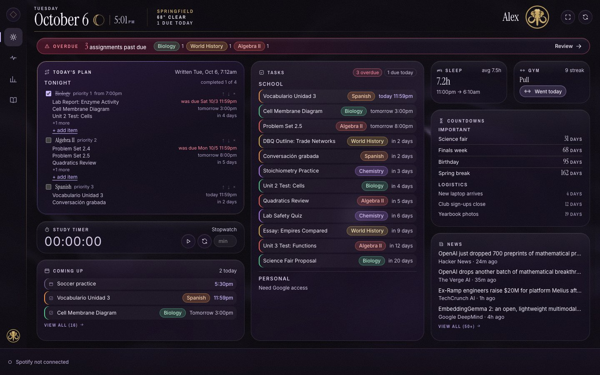

Every screenshot here uses a demo profile with made-up classes and assignments. No real data.

---

## What it does

### Today

The home screen. No scrolling, ever. Every panel fits the window, and long lists scroll inside their own panel.

- **Today's Plan.** Claude reads my calendar, my Canvas deadlines and my to-dos, then writes the three things that matter most and where they fit in my free time. It writes one plan a day and keeps it, so refreshing costs nothing. If the plan is from yesterday, it says so.
- **Tonight.** A plan I write myself and pin on top. Class by class, in the order I'll actually work, each with its real assignments listed underneath. I tick them off as I go. It clears itself at midnight.
- **Tasks.** School on top (Canvas assignments by class), personal below (Google Tasks). Ticking a personal task marks it done in Google too.
- **Coming up.** Calendar events and Canvas deadlines for the next two weeks, mixed by date, with a small icon so you can tell them apart.
- **Study timer.** Stopwatch, or type minutes for a countdown. It survives a reload.
- **Countdowns.** Two tiers. Important ones big, logistics small and quiet.
- **Overdue strip.** Only shows up when something is late.

### Body and stats

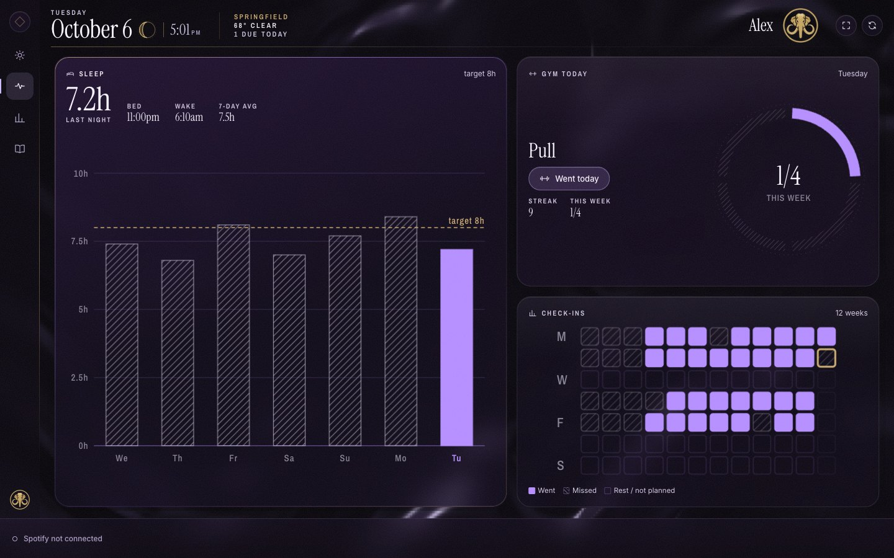

Sleep against an 8 hour target, gym check-ins on a 12 week grid, and a stats screen with the trends. Sleep can come from a form, an iPhone Shortcut, or a WHOOP band.

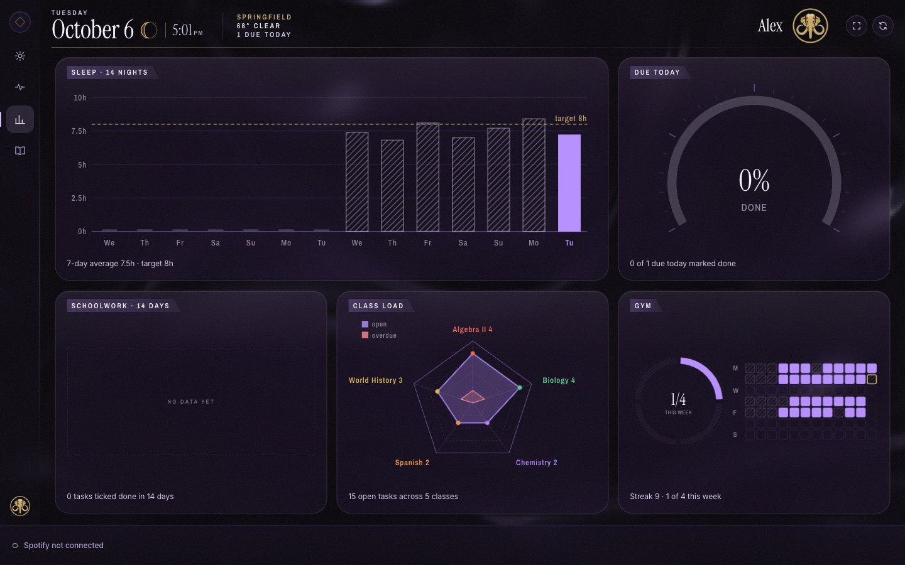

### Classes

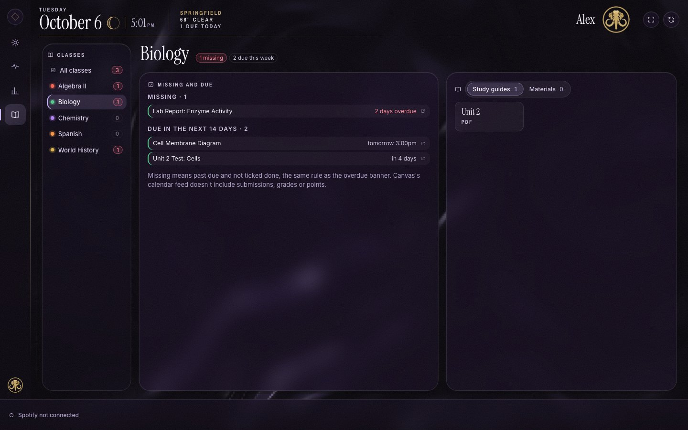

One page per class. What's missing, what's due in the next two weeks, and a shelf of study guides and class files that open right inside the dashboard.

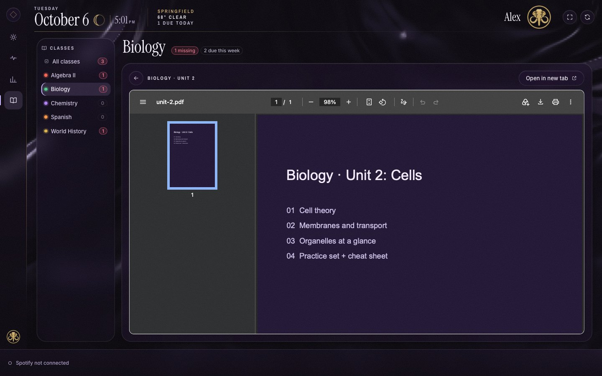

### Details

Every panel opens into a full view.

| Tasks and deadlines | Today's plan |
|---|---|
| 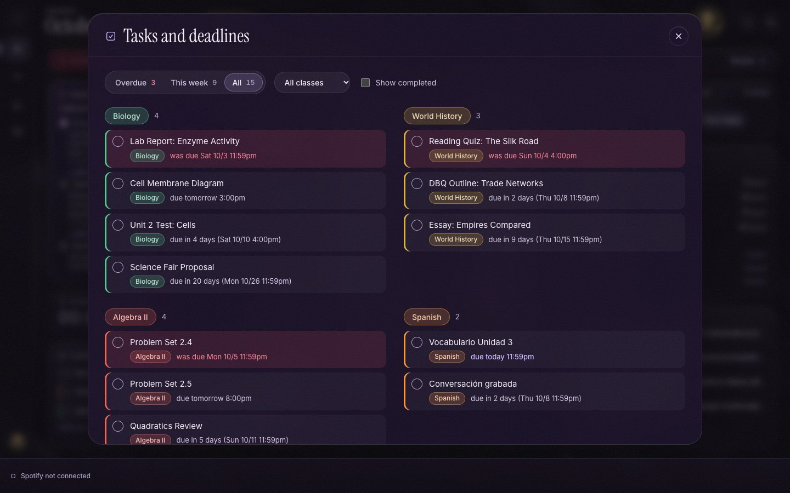 | 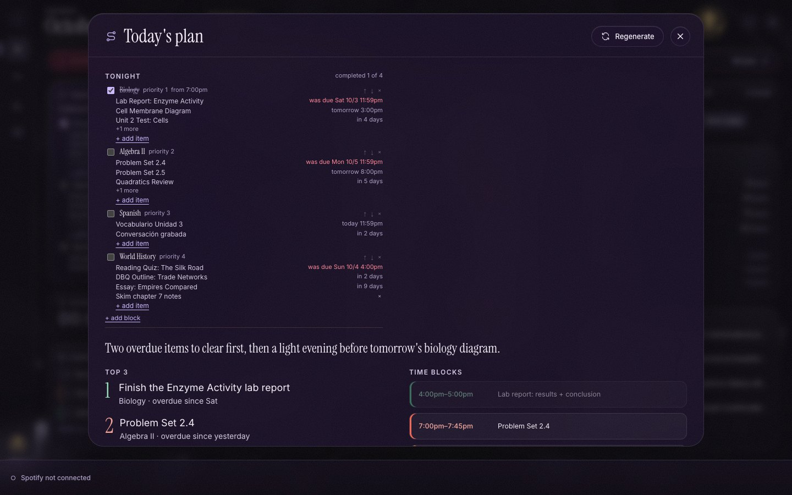 |

### Themes and brightness

The diamond in the corner opens settings. Nine themes, and a brightness slider for late nights.

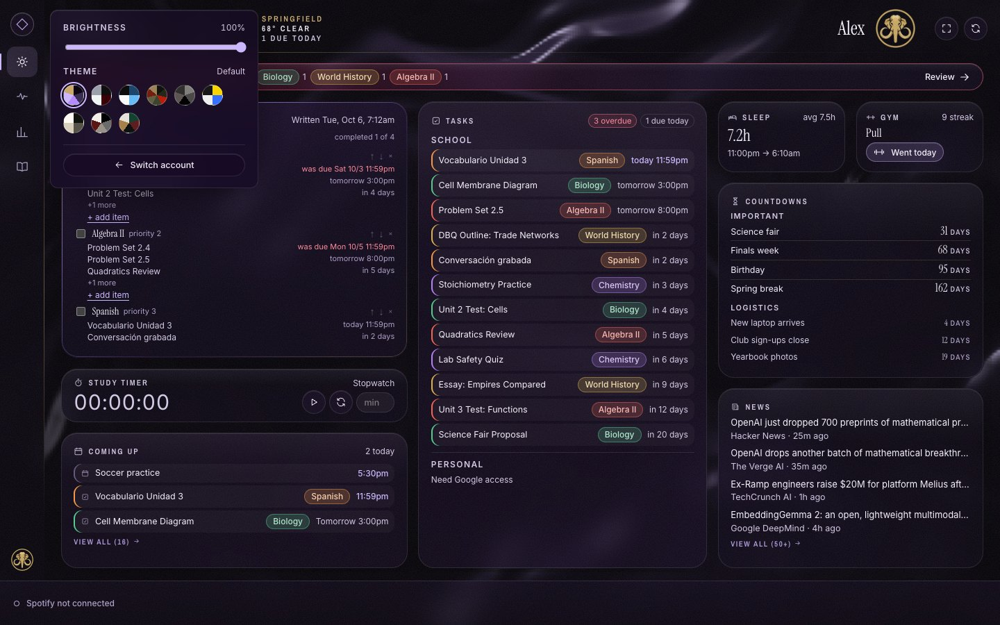

| Eliza | Clustr | Koi Pond |
|---|---|---|
| 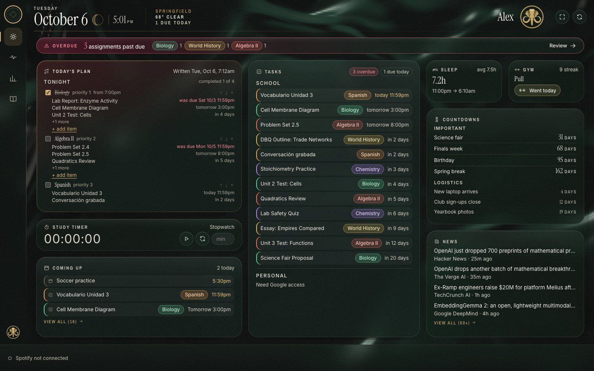 | 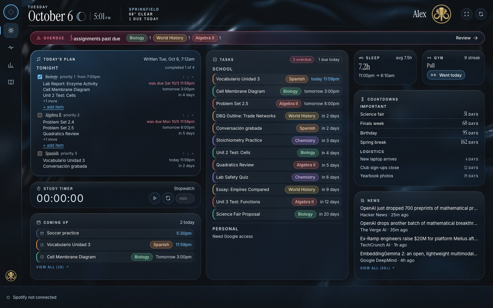 | 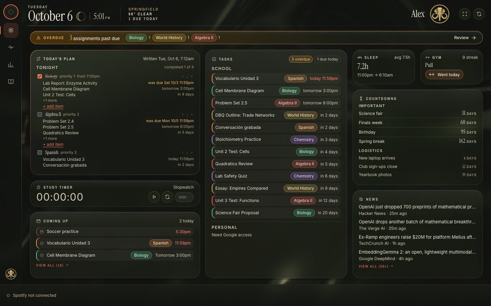 |

Switching themes never touches the layout. Overdue stays readable in every one: on themes that are already red, the warning turns amber so it doesn't blend in.

### Profiles

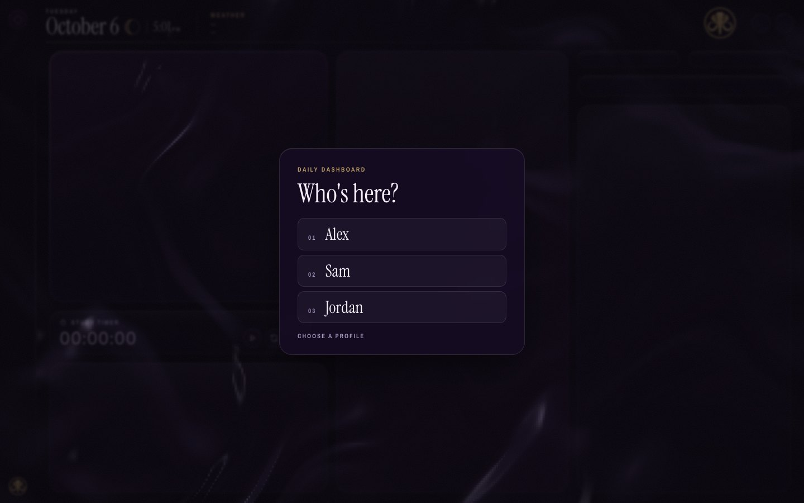

The intro builds the screen out of glass triangles, then asks who's here. Each profile has its own data, settings and logo. One profile can never see another's.

### On a phone

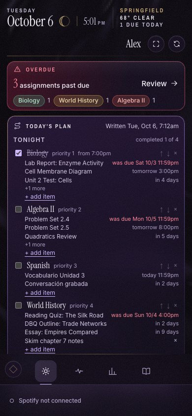

On a phone it turns into one scrolling column with the screen switcher at the bottom.

---

## How it's built

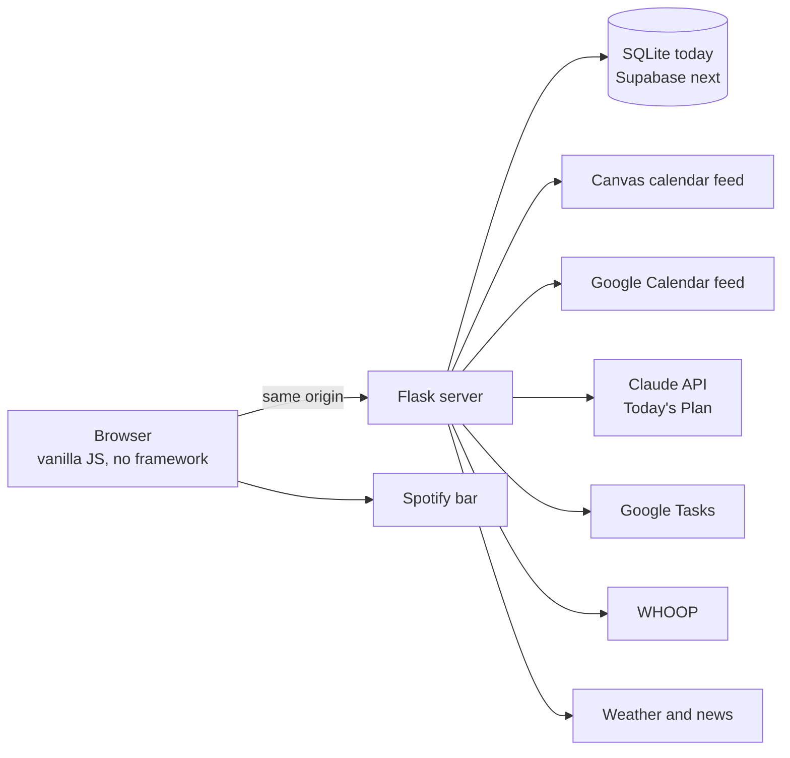

- **Server:** Python and Flask. Every module (Canvas, calendar, plan, sleep, gym, stats) is its own small file with one `get_data()`. If one fails, only its panel shows an error. The rest keeps working.
- **Page:** plain HTML, CSS and JavaScript. No framework, no build step. Charts are hand-drawn SVG.
- **Look:** dark frosted glass over a slow liquid-metal background rendered in WebGL. Fonts are Instrument Serif, Inter and Archivo Narrow. Every color is a CSS variable, which is what makes themes possible.
- **Plan:** Claude, with structured output, so the reply always comes back in the exact shape the panel needs.
- **Data:** SQLite now, keyed by profile on every row. Moving to Supabase with row level security, so the database itself refuses to show one user another user's rows.

More detail in [docs/ARCHITECTURE.md](docs/ARCHITECTURE.md).

## Privacy

Secrets never reach the browser. Feed links, API keys and login tokens stay on the server. The page only ever gets the data for whoever is signed in.

That's also why the code is private. It was built around my own accounts, and I'd rather show how it works than hand out a copy.

## Status

It runs every day on my laptop.

Next:
1. Real accounts with email login (Supabase Auth).
2. Hosting on Render, so it works from any device.
3. Google, Spotify and WHOOP connections per user.

---

Built by Ivan Martinez Medina.
